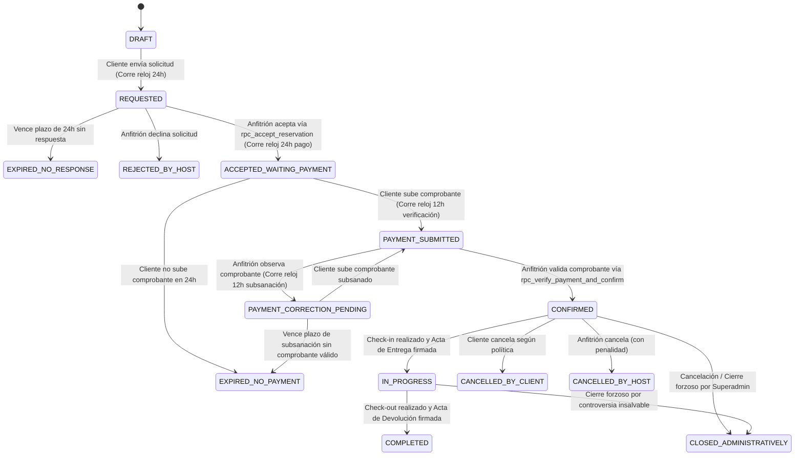

# BUSINESS_RULES.md — Reglas del Negocio de LOKEATE

> **ESTADO DEL DOCUMENTO:** REVISADO, AUDITADO Y SINCRONIZADO (Fase 0 — Documentación Maestra)  
> **PROPÓSITO:**  
> Este documento compila las invariantes lógicas, restricciones operativas, políticas contractuales y directivas de seguridad aplicables a **LOKEATE**. Toda regla aquí establecida es de obligado cumplimiento en el código de la aplicación, esquemas de base de datos, políticas de RLS e interfaces de usuario.

---

## 1. Reglas de Disponibilidad, Calendarios, Recursos Compartidos y Concurrencia

### `BR-DISP-001`: Incompatibilidad Jerárquica y de Recursos Compartidos
- **Invariante:** En ningún caso se permitirá que dos eventos confirmados o en proceso de pago compartan un mismo espacio físico ni un recurso exclusivo en rangos temporales que se solapen.
- **Relación Jerárquica Establecimiento vs. Espacios:**
  1. Si un cliente reserva el **Establecimiento Completo** (`is_entire_establishment = TRUE`), todos los subespacios individuales pertenecientes a dicho establecimiento quedan **inhabilitados y bloqueados** de forma automática para ese rango temporal.
  2. Si un cliente mantiene una reserva activa sobre un **subespacio individual** (ej. "Jardín Principal"), queda **terminantemente prohibido** que otro cliente reserve el "Establecimiento Completo" para ese mismo rango de horas.
- **Recursos Compartidos Exclusivos (`shared_resources`):**
  - Si dos subespacios comparten un recurso catalogado como exclusivo (ej. cocina para catering o piscina central), la reserva de uno inhabilita al otro durante ese rango temporal si ambos tienen activada la exclusividad del recurso.
- **Bloqueos Manuales e iCal (`availability_blocks`):**
  - Las fechas bloqueadas manualmente por el anfitrión o importadas automáticamente desde calendarios externos `.ics` tienen el mismo nivel de prioridad que una reserva confirmada, impidiendo nuevas solicitudes en ese rango.
- **Implementación Técnica Obligatoria:**
  - Restricción de exclusión física GiST (`EXCLUDE USING gist`) en PostgreSQL sobre el espacio individual y sobre la tabla de bloqueos.
  - Función atómica `check_bidirectional_availability_conflicts` con bloqueo a nivel de fila (`SELECT 1 FROM establishments WHERE id = ... FOR UPDATE`) que serializa las transacciones concurrentes e impide carreras críticas (*race conditions*).

### `BR-DISP-002`: Margen Técnico Obligatorio (*Buffers* de Montaje y Limpieza)
- Todo espacio tiene configurado un margen previo (*setup buffer*) y un margen posterior (*cleanup buffer*):
  - *Buffer de montaje/decoración:* Mínimo configurable por el anfitrión (valor base sugerido: 60 minutos) `[PARÁMETRO CONFIGURABLE / PENDIENTE DE VALIDACIÓN]`.
  - *Buffer de desmontaje/limpieza:* Mínimo configurable por el anfitrión (valor base sugerido: 60 minutos) `[PARÁMETRO CONFIGURABLE / PENDIENTE DE VALIDACIÓN]`.
- El rango temporal computado en el calendario (`time_range`) abarca obligatoriamente:  
  `[hora_inicio - setup_buffer, hora_fin + cleanup_buffer]`.
- Ninguna solicitud de reserva ni bloqueo manual puede solaparse con los márgenes técnicos de otro evento.

---

## 2. Configuración Geográfica y Moderación de Establecimientos

### `BR-GEO-001`: Restricción de Activación por Zona de Lanzamiento
- Aunque el modelo de datos soporta los 24 departamentos y distritos del Perú, un establecimiento solo puede marcarse como `is_active = TRUE` si su distrito pertenece a una zona de lanzamiento oficialmente habilitada (`districts.is_launch_zone = TRUE`).
- Durante la Fase Beta, la zona habilitada está restringida a distritos seleccionados de Lima Metropolitana y zonas campestres/recreativas aledañas (Cieneguilla, Pachacamac, Lurín, Chaclacayo, Chosica, Playas del Sur). `[PROPUESTA PENDIENTE DE EXPANSIÓN POST-BETA PARA PROVINCIAS]`.

### `BR-EST-001`: Publicación Exclusiva tras Aprobación por la Administración
- Todo establecimiento nuevo nace con `publishing_status = 'DRAFT'`.
- El anfitrión puede solicitar revisión (`SUBMITTED_FOR_REVIEW`), pero **únicamente el Superadministrador** tiene facultades para cambiar el estado a `APPROVED`.
- Queda terminantemente prohibido activar (`is_active = TRUE`) cualquier establecimiento que no cuente con el estado `APPROVED`.

---

## 3. Múltiples Planes Tarifarios y Motor RealPrice

### `BR-PRICE-001`: Múltiples Planes Tarifarios Alternativos por Espacio
Un espacio puede configurar y publicar simultáneamente múltiples planes tarifarios en `space_pricing_plans`:
1. **Plan por Hora (`HOURLY`):** Tarifa multiplicada por las horas efectivas, exigiendo un mínimo de horas contratables (`minimum_rental_hours`).
2. **Plan por Evento Fijo (`FIXED_EVENT`):** Monto plano por el bloque acordado del evento, independientemente de si dura menos horas que el máximo permitido.
3. **Plan por Persona (`PER_PERSON`):** Tarifa unitaria multiplicada por la cantidad de asistentes confirmados, sujeta a un mínimo facturable (`minimum_billable_guests`).
4. **Plan Paquete Cerrado (`PACKAGE`):** Tarifa cerrada integral que incluye el espacio físico y un set predefinido de equipamiento/servicios.

**Regla de Negocio:** El cliente selecciona **un único plan tarifario** al momento de cotizar o solicitar la reserva. Queda terminantemente prohibido sumar automáticamente las modalidades.

### `BR-PRICE-002`: Desglose Integral de RealPrice
El motor RealPrice debe calcular y exponer el desglose económico transparente antes de que el cliente emita la solicitud y antes de que el anfitrión la acepte:
1. **Tarifa Base del Plan Seleccionado:** Computada estrictamente según el plan tarifario elegido.
2. **Ajuste Estacional y por Calendario:** Recargos o descuentos por fines de semana, temporadas altas o feriados calendario peruanos oficiales.
3. **Horas Adicionales:** Computadas únicamente si el evento pactado excede la duración base del plan.
4. **Cargos Adicionales Configurables:** Servicios opcionales o fijos seleccionados (limpieza post-evento, descorche de bebidas, uso de grupo electrógeno).
5. **Descuentos Parametrizados:** Descuentos promocionales por reserva anticipada (*early bird*), días laborables (*weekday*) o cupones válidos.
6. **Condición Tributaria e Impuestos:**
   - *Exonerado / No Sujeto a IGV:* Solo cuando corresponda según evaluación tributaria individual y normativa peruana vigente; no inferirlo automáticamente de la condición de persona natural.
   - *IGV Incluido (18%):* El importe pactado ya incluye el Impuesto General a las Ventas.
   - *IGV Adicional (18%):* Se aplica solo cuando la operación está gravada y el régimen tributario del emisor lo exige; no depende únicamente de que el cliente solicite factura.
7. **Tarifa de Servicio LOKEATE (`service_fee_platform`):** Establecida en `S/ 0.00` durante la Fase Beta. `[PENDIENTE DE APROBACIÓN COMERCIAL POST-BETA]`.
8. **Depósito de Garantía por Daños:** Importe fijo reembolsable en custodia directa del anfitrión.
9. **Importe Total Contractual:** Sumatoria líquida expresada en Soles (`PEN`).
10. **Anticipo Requerido para Confirmación:** Porcentaje pactado en el plan (por defecto 50%) `[PARÁMETRO CONFIGURABLE / PENDIENTE DE DEFINICIÓN]`.
11. **Cronograma de Saldo:** Fecha límite para el pago del saldo restante.

### `BR-PRICE-003`: Inmutabilidad Absoluta de Snapshots Económicos (Append-Only)
- Toda cotización aceptada o solicitud genera un registro en `reservation_snapshots` (`version = 1`).
- La tabla `reservation_snapshots` es **estrictamente de inserción exclusiva (append-only)**. Está terminantemente prohibido actualizar o borrar registros de snapshots; la reserva apunta al snapshot vigente mediante `reservations.current_snapshot_id`.
- Se garantiza declarativamente mediante clave foránea compuesta que `current_snapshot_id` pertenece obligatoriamente a la misma reserva.

---

## 4. Ciclo de Vida de la Reserva y Funciones Transaccionales

### `BR-REQ-001`: Máquina de Estados Operativos de la Reserva
El ciclo operativo de una reserva está gobernado exclusivamente por la columna `status`:

### `BR-REQ-002`: Eliminación de Actualizaciones Directas Inseguras (Transacciones RPC)
- Queda terminantemente prohibido que las transiciones de estado de `reservations` se realicen mediante sentencias `UPDATE` directas desde el cliente en PostgREST.
- Todas las mutaciones de estado se ejecutan mediante las funciones transaccionales seguras del motor:
  - `rpc_accept_reservation`: Valida ventanas temporales de 24h y bloquea preventivamente.
  - `rpc_verify_payment_and_confirm`: Valida el abono del anticipo y bloquea en firme.
  - `rpc_cancel_reservation`: Ejecuta penalidades y libera calendarios.
  - `rpc_admin_close_reservation`: Cierre administrativo por el Superadministrador.

### `BR-REQ-003`: Integridad Estricta de Entidades en Reservas
- Toda reserva valida mediante triggers de integridad que:
  1. El espacio pertenezca al establecimiento declarado.
  2. El anfitrión sea el propietario legítimo del establecimiento.
  3. El plan tarifario pertenezca al espacio contratado.

### `BR-REQ-004`: Ventanas de Tiempo y Plazos del Negocio
1. **Ventana 1 — Aceptación del Anfitrión:** Máximo **24 horas continuas** desde la emisión de la solicitud. Si vence sin acción, pasa automáticamente a `EXPIRED_NO_RESPONSE`.
2. **Ventana 2 — Pago y Presentación de Comprobante del Cliente:** Máximo **24 horas continuas** desde la aceptación de la solicitud. Si vence sin comprobante, pasa automáticamente a `EXPIRED_NO_PAYMENT` y libera de inmediato el bloqueo preventivo del calendario.
3. **Ventana 3 — Verificación del Anfitrión:** Máximo **12 horas continuas** desde la carga del comprobante (`PAYMENT_SUBMITTED`).
4. **Ventana 4 — Subsanación de Comprobante Observado:** Si el anfitrión observa inconsistencias en el comprobante, pasa a `PAYMENT_CORRECTION_PENDING`. El cliente tiene una ventana de **12 horas adicionales** para cargar el comprobante subsanado.

---

## 5. Pagos, Cuotas y Devoluciones en la Fase Beta

### `BR-PAY-001`: Declaración de Pagos Fuera de Plataforma
- Durante la Fase Beta, LOKEATE no actúa como pasarela de pago, intermediario financiero ni custodio de fondos.
- Todos los anticipos, saldos y depósitos de garantía se pagan directamente entre cliente y anfitrión mediante canales bancarios peruanos (Transferencias BCP, BBVA, Interbank, Scotiabank, Yape, Plin).
- El cliente declara el pago subiendo la imagen o PDF del comprobante (`proof_storage_path`), número de operación y banco emisor.

### `BR-PAY-002`: Cronograma de Cuotas (`reservation_installments`)
- El pago de una reserva se estructura en cuotas formales registradas en el sistema:
  - *Cuota 1 (Anticipo Obligatorio):* Requerido para confirmar la reserva (típicamente 50%).
  - *Cuota 2 (Saldo Restante):* Debe ser cancelada y verificada antes del inicio del evento según el cronograma acordado.

### `BR-PAY-003`: Devoluciones Informativas Calculadas
- LOKEATE **no ejecuta transferencias bancarias de reembolso**.
- En caso de cancelación que amerite devolución, el sistema calcula el importe exacto a restituir según la política contractual pactada, genera una orden de devolución informativa (`refund_records`) y fija la obligación del anfitrión de transferir los fondos directamente al cliente y registrar la constancia bancaria respectiva.

---

## 6. Políticas de Cancelación (Modelos Parametrizados)

> [!WARNING]
> **ESTADO LEGAL:** Los porcentajes y plazos a continuación constituyen una **`[PROPUESTA PENDIENTE DE REVISIÓN Y APROBACIÓN LEGAL]`**. Cada espacio configura uno de estos tres modelos en su ficha:

| Modelo de Cancelación | Cancelación con > 30 días de anticipación | Cancelación entre 15 y 30 días antes | Cancelación con < 15 días de anticipación |
|---|---|---|---|
| **Flexible** `[PROPUESTA]` | Devolución sugerida del 100% del anticipo. | Devolución sugerida del 50% del anticipo. | Sin derecho a devolución del anticipo. |
| **Moderada** (Sugerida por defecto) `[PROPUESTA]` | Devolución sugerida del 50% del anticipo. | Devolución sugerida del 25% del anticipo. | Sin derecho a devolución del anticipo. |
| **Estricta** `[PROPUESTA]` | Devolución sugerida del 25% del anticipo. | Sin derecho a devolución del anticipo. | Sin derecho a devolución del anticipo. |

### `BR-CANC-001`: Cancelación Culpable por Parte del Anfitrión
- Si un anfitrión cancela unilateralmente una reserva ya confirmada sin justificación de fuerza mayor debidamente acreditada:
  1. Debe devolver el **100% de cualquier anticipo y garantía cobrada** en un plazo máximo de **24 horas**.
  2. Su cuenta queda sujeta a penalidades de visibilidad y suspensión por reincidencia.
  3. La fecha cancelada queda bloqueada para ese anfitrión, impidiendo que vuelva a publicarla a mayor precio.

---

## 7. Depósitos de Garantía y Procedimiento de Reclamo por Daños

### `BR-GAR-001`: Plazos de Garantía y Daños Acordados
Para otorgar certeza jurídica y evitar retenciones arbitrarias o reclamos tardíos, se establecen los siguientes plazos improrrogables:
1. **Plazo de Reclamación de Daños por el Anfitrión:**  
   El anfitrión dispone de un plazo máximo de **48 horas continuas** tras la hora de término del evento para abrir formalmente un expediente de daños (`damage_claims`) en la plataforma. Todo reclamo formulado después de las 48 horas se considerará extemporáneo e improcedente.
2. **Plazo de Respuesta del Cliente:**  
   El cliente dispone de un plazo de **72 horas continuas** desde la notificación del reclamo para:
   - Aceptar el reclamo y autorizar el descuento sobre la garantía.
   - Formular descargos, observaciones o contraoferta con sus propias pruebas.
3. **Plazo de Devolución de la Garantía No Controvertida:**  
   Si el anfitrión no formula reclamo de daños dentro de las 48 horas post-evento (o si el Acta de Devolución certifica plena conformidad), el anfitrión está obligado a reembolsar la totalidad del depósito de garantía al cliente en un plazo máximo de **7 días calendario** `[PLAZO SUJETO A VALIDACIÓN LEGAL FINAL]`.

---

## 8. Inventario y Actas Digitales de Entrega y Devolución

### `BR-ACT-001`: Acta de Entrega (Check-in)
- Al ingresar al inmueble, ambas partes verifican el checklist de inventario digital (mobiliario, equipos, servicios sanitarios, lectura de medidores eléctricos y de agua).
- Ambas partes suscriben digitalmente el acta en la aplicación mediante mecanismo clickwrap con captura de identificador de usuario, dirección IP y marca de tiempo ISO 8601.

### `BR-ACT-002`: Acta de Devolución (Check-out)
- Al término del evento y retiro de los invitados/proveedores, se suscribe el Acta de Devolución.
- Si no existen observaciones ni daños, la firma de esta acta habilita automáticamente el cronograma de restitución íntegra de la garantía.

---

## 9. Marco Legal y Tributario en el Perú (SUNAT)

### `BR-DOC-001`: Descargo Legal Obligatorio SUNAT
- **Invariante Legal:** Ningún documento emitido por LOKEATE (Resumen de Reserva, Contrato Privado de Alquiler de Espacio para Eventos o Acta de Entrega) constituye, sustituye ni equivale a una Boleta de Venta o Factura con validez tributaria ante la SUNAT.
- Es responsabilidad exclusiva y excluyente del anfitrión emitir el comprobante tributario legal correspondiente según su régimen tributario peruano (Segunda Categoría, RUS, RER, MYPE Tributario o Régimen General).

---

## 10. Privacidad y Protección de Datos Personales (Ley N° 29733)

### `BR-PRIV-001`: Ocultamiento Preventivo de Ubicación Exacta
- En el catálogo público y solicitudes no confirmadas, el sistema expone únicamente: departamento, provincia, distrito y ubicación aproximada referencial (coordenada perturbada en radio aproximado de 500m).
- La **dirección exacta, número de inmueble, piso, referencias de llegada y teléfonos de contacto** están almacenados en `establishment_locations_private` y **únicamente se revelan al cliente cuando la reserva alcanza el estado `CONFIRMED` o `IN_PROGRESS`**.

### `BR-PRIV-002`: Cero Exposición de Documentos de Identidad entre Partes
- La contraparte de una reserva jamás tiene acceso al DNI, Carné de Extranjería o RUC de la otra parte mediante consultas al sistema (`profile_private_details` está estrictamente aislado por RLS).
- La coordinación operativa entre cliente y anfitrión se realiza dentro del chat interno de la plataforma o mediante teléfono de contacto revelado únicamente tras confirmarse la reserva.

---

## 11. Reseñas y Calificaciones Bidireccionales

### `BR-REV-001`: Sistema de Evaluación y Publicación Ciega
- Solo los usuarios con una reserva en estado `COMPLETED` están autorizados para emitir reseñas.
- Periodo de evaluación: Hasta **14 días calendario** posteriores a la conclusión del evento.
- **Mecanismo de Doble Ciego:** Las calificaciones y comentarios permanecen ocultos hasta que ambas partes hayan enviado su reseña o hasta que expire el plazo de 14 días.
- El anfitrión tiene derecho a publicar una única respuesta pública respetuosa a cada reseña recibida.

---

## 12. Registro de Parámetros y Decisiones Pendientes de Aprobación

Los siguientes parámetros están catalogados como **`[PENDIENTES DE DEFINICIÓN COMERCIAL O VALIDACIÓN LEGAL]`**:

1. **`[PENDIENTE]` Porcentaje exacto de comisión de plataforma LOKEATE post-beta:**  
   Definido en `S/ 0.00` para la Beta. Pendiente determinar si post-beta será un porcentaje fijo sobre el alquiler (ej. 8% a 12%) o tarifa por servicio compartida.
2. **`[PENDIENTE]` Porcentaje de anticipo obligatorio por defecto:**  
   Modelado como parámetro por plan tarifario, con valor de referencia del 50%.
3. **`[PENDIENTE]` Porcentajes definitivos de las políticas de cancelación:**  
   La matriz actual (Flexible: 100/50/0%, Moderada: 50/25/0%, Estricta: 25/0/0%) constituye una propuesta sujeta a dictamen de asesoría legal contractual.
4. **`[PENDIENTE]` Requisitos documentarios definitivos para verificación KYC de locales:**  
   En Beta se admite DNI/RUC con revisión manual del Superadministrador. Pendiente definir si se exigirá copia literal de SUNARP con vigencia no mayor a 30 días o declaración jurada simple.
5. **`[PENDIENTE]` Plazo de devolución no controvertida de la garantía (7 días calendario):**  
   Sujeto a validación legal según el Código Civil peruano en materia de arrendamiento temporal.

## 11. Salvaguardas técnicas pendientes de pruebas

La disponibilidad debe validarse **en ambas direcciones**: nuevas reservas contra bloqueos existentes y nuevos bloqueos contra reservas ya aceptadas, incluyendo establecimiento completo, recursos exclusivos e iCal. Los estados vencidos se registrarán mediante procesos idempotentes sin lanzar excepciones después de actualizar la misma transacción. Las declaraciones de pago deben validarse contra el anticipo exigible y el estado pendiente; una declaración no equivale a dinero recibido. La garantía reembolsable se desglosará separadamente del precio del servicio. Las políticas tributarias y los plazos contractuales sujetos a revisión legal no se considerarán certificados hasta su aprobación.
