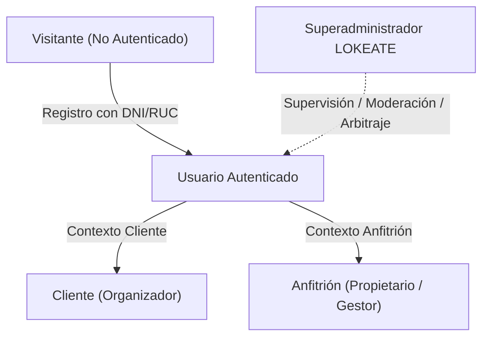

# PROJECT.md — Especificación Funcional Consolidada de LOKEATE

> **ESTADO DEL DOCUMENTO:** REVISADO, AUDITADO Y SINCRONIZADO (Fase 0 — Documentación Maestra)  
> **VISIÓN DEL PRODUCTO:**  
> **LOKEATE** es la plataforma digital de marketplace especializada para el mercado peruano orientada al alquiler temporal de establecimientos, locales, salones, quintas campestres, terrazas, haciendas, almacenes y espacios acondicionados para eventos sociales, corporativos, culturales, recreativos e infantiles. Conecta anfitriones (propietarios o gestores) con clientes organizadores bajo estándares estrictos de transparencia económica (RealPrice), seguridad, actas de entrega/devolución y prevención técnica de doble reserva (*double-booking*).

---

## 1. Configuración Geográfica Nacional y Zonas de Lanzamiento Habilitables

LOKEATE adopta la codificación territorial oficial del Perú (Ubigeo INEI: Departamento, Provincia, Distrito) mediante un modelo de **zonas de lanzamiento habilitables**:

```
[Nivel Nacional: 24 Departamentos + Callao]
      │
      └── [Provincias y Distritos]
            ├── Zona Habilitada (is_launch_zone = TRUE): Lima Metropolitana y Zonas Campestres
            │     ├── Cieneguilla, Pachacamac, Lurín, Chaclacayo, Chosica
            │     └── Miraflores, Barranco, San Isidro, Surco, La Molina, Playas del Sur
            │
            └── Zonas en Reserva (is_launch_zone = FALSE): [PROPUESTA PENDIENTE DE EXPANSIÓN POST-BETA]
                  └── Arequipa, Trujillo, Cusco, Chiclayo, Piura, Huancayo
```

- **Invariante Geográfica:** Un anfitrión puede registrar cualquier inmueble con su Ubigeo exacto, pero el establecimiento solo podrá activarse y publicarse en el marketplace si su distrito pertenece a una zona de lanzamiento habilitada (`districts.is_launch_zone = TRUE`) y ha sido formalmente aprobado por la administración.
- **Moneda Base:** Sol Peruano (`PEN`, símbolo `S/`). Tipado decimal estricto (`NUMERIC(12,2)`).

---

## 2. Modelo de Actores y Roles

LOKEATE utiliza un modelo de cuentas unificado donde un usuario autenticado puede alternar entre funciones de Cliente y Anfitrión sin duplicar credenciales:



### 2.1. Visitante (Público General No Autenticado)
- Explora el marketplace con filtros por distrito, aforo, tipo de evento, servicios y fechas.
- Visualiza la ficha pública de los espacios: fotos, características, planes tarifarios base, estimación de RealPrice y ubicación referencial aproximada (distrito y zona general).
- **Restricción de Privacidad:** Jamás visualiza la dirección exacta, piso, referencia física, teléfonos ni datos bancarios del anfitrión.

### 2.2. Cliente (Organizador del Evento)
- Usuario con DNI, Carné de Extranjería (CE) o RUC registrado en `profile_private_details` (protegido contra lectura de terceros).
- Solicita cotizaciones formales eligiendo entre los diferentes planes tarifarios ofrecidos por el espacio.
- Emite solicitudes de reserva con fecha, horarios y aforo proyectado.
- Declara pagos de anticipos y cuotas subiendo comprobantes bancarios realizados fuera de la plataforma (BCP, BBVA, Interbank, Scotiabank, Yape, Plin).
- En caso de observación del comprobante, realiza subsanaciones dentro de la ventana de 12 horas autorizada.
- Solicita modificaciones de fecha/aforo sobre reservas confirmadas.
- Suscribe digitalmente las Actas de Entrega (Check-in) y Devolución (Check-out) con inventario y fotos.
- Responde a reclamos de garantía por daños dentro del plazo de 72 horas.
- Emite reseñas y calificaciones tras la conclusión del evento.

### 2.3. Anfitrión (Propietario o Gestor de Inmuebles)
- Administra uno o varios **Establecimientos**, los cuales pasan por moderación obligatoria (`publishing_status = 'APPROVED'`) antes de ser visibles en el marketplace.
- Configura uno o varios **Espacios** por establecimiento (o la opción de "Establecimiento Completo").
- Configura recursos compartidos entre espacios (ej. piscina o cocina de uso exclusivo).
- Define **múltiples planes tarifarios alternativos** por espacio (ej. plan por hora, paquete integral, turno fijo).
- Revisa solicitudes de reserva en un plazo máximo de **24 horas** mediante funciones transaccionales seguras (`rpc_accept_reservation`).
- Verifica abonos de anticipo en su cuenta bancaria en un plazo máximo de **12 horas** (`rpc_verify_payment_and_confirm`).
- Conecta calendarios externos vía importación iCal y exporta sus reservas mediante feed iCal privado.
- Gestiona el inventario de bienes y firma digitalmente las Actas de Entrega y Devolución con registro fotográfico.
- Formula reclamos formales sobre la garantía por daños dentro de **48 horas** post-evento.
- Devuelve depósitos de garantía no controvertidos en un plazo de **7 días calendario** post-evento.

### 2.4. Superadministrador (Líder Técnico y Operativo LOKEATE)
- Verifica la identidad de los anfitriones y la legitimidad de sus locales.
- Modera y aprueba establecimientos para permitir su publicación (`publishing_status = 'APPROVED'`).
- Activa o desactiva zonas geográficas de lanzamiento (`districts.is_launch_zone`).
- Dirime controversias y arbitra disputas (`dispute_status`) cuando cliente y anfitrión no logran acuerdo.
- Ejecuta cierres administrativos (`CLOSED_ADMINISTRATIVELY`) de reservas abandonadas o viciadas.
- Configura catálogos maestros y supervisa los registros de auditoría inmutables.

---

## 3. Jerarquía Inmueble y Recursos Compartidos

```
[Establecimiento: "Fundo San Fernando - Cieneguilla"]
      │
      ├── Opción Exclusiva: [Espacio: "Fundo Completo"] (is_entire_establishment = TRUE)
      │
      ├── Subespacio A: [Espacio: "Jardín Principal"] ──┐
      │                                                 ├─► [Recurso Compartido Exclusivo: "Piscina Central"]
      ├── Subespacio B: [Espacio: "Terraza Campestre"] ──┘
      │
      └── Subespacio C: [Espacio: "Salón Rústico Cerrado"]
```

- **Alquiler de Subespacio Individual:** Alquilar el "Salón Rústico" bloquea la posibilidad de alquilar el "Fundo Completo" para ese mismo rango de horas, pero mantiene disponibles los demás subespacios independientes.
- **Alquiler de Establecimiento Completo:** Alquilar el "Fundo Completo" bloquea automáticamente **todos** los subespacios hijos durante ese rango temporal.
- **Recursos Compartidos Exclusivos:** Si el "Jardín Principal" y la "Terraza Campestre" comparten el uso exclusivo de la "Piscina Central", reservar uno de ellos bloquea al otro si ambos pretenden utilizar dicho recurso en horarios que se solapen.

---

## 4. Múltiples Planes Tarifarios por Espacio y Motor RealPrice

### 4.1. Soporte para Múltiples Planes Tarifarios Alternativos
Un mismo espacio puede publicar varios planes de precios para adaptarse a diferentes tipos de clientes y presupuestos:
- **Plan A — Tarifa por Hora (`HOURLY`):** S/ 300 por hora (mínimo 5 horas). Ideal para cumpleaños o talleres diurnos.
- **Plan B — Paquete Integral para Bodas (`PACKAGE`):** S/ 6,500 por bloque de 10 horas, incluyendo mobiliario para 150 personas y descorche libre.
- **Plan C — Evento Corporativo por Persona (`PER_PERSON`):** S/ 85 por asistente (mínimo 60 personas).
- **Plan D — Turno Nocturno Fijo (`FIXED_EVENT`):** S/ 4,000 por el turno de 18:00 a 02:00.

**Regla de Negocio:** El cliente selecciona **un único plan tarifario** al momento de cotizar o solicitar la reserva. Las modalidades no se suman automáticamente.

### 4.2. Motor RealPrice
RealPrice calcula el presupuesto transparente y sin cargos ocultos:

$$\text{RealPrice Total} = \text{Tarifa del Plan Seleccionado} + \text{Horas Extra} + \text{Cargos Adicionales} - \text{Descuentos} + \text{Impuestos} + \text{Garantía}$$

- **Tarifas Especiales por Temporada:** Recargos o descuentos por fechas festivas peruanas (Fiestas Patrias, Año Nuevo) o fines de semana.
- **Condición Tributaria Configurable:** Exonerado (personas naturales), IGV incluido (18%) o IGV adicional (18%) para facturación comercial.
- **Tarifa de Servicio LOKEATE (`service_fee_platform`):** `S/ 0.00` durante la Fase Beta. `[PENDIENTE DE DEFINICIÓN COMERCIAL POST-BETA]`.
- **Snapshots Económicos Inmutables:** El registro en `reservation_snapshots` es **estrictamente de inserción exclusiva (append-only)**; la reserva apunta al snapshot activo mediante `reservations.current_snapshot_id`, con garantía relacional compuesta asegurando que el snapshot pertenezca a la misma reserva.

---

## 5. Arquitectura de Privacidad y Protección de Datos

1. **Aislamiento Físico de Ubicación:**
   - La tabla pública `establishments` solo almacena el distrito y coordenadas aproximadas (~500m) para el mapa.
   - La dirección exacta, referencias de acceso y teléfonos residen exclusivamente en `establishment_locations_private`.
   - **Regla RLS:** Solo accesible por el anfitrión propietario, por clientes con reserva `CONFIRMED` o `IN_PROGRESS`, o por el Superadministrador.
2. **Segregación de Datos Personales de Usuarios:**
   - La tabla `profiles` expone únicamente nombre, apellido y avatar para interactuar en la plataforma.
   - La tabla `profile_private_details` resguarda el DNI, Carné de Extranjería, RUC y teléfono personal. Ninguna contraparte puede consultar esta tabla; el contacto operativo se canaliza exclusivamente tras confirmarse la reserva.
3. **Documentos Privados (Supabase Storage):**
   - Vouchers, DNI/RUC y fotos de actas se almacenan en el bucket privado `private-documents` con acceso público denegado. Se sirven mediante URLs firmadas con vigencia máxima de **15 minutos**.

---

## 6. Sincronización de Disponibilidad e Integración iCal en la Beta

1. **Exportación iCal (Saliente):** Cada espacio cuenta con un feed `.ics` protegido por un token privado único (`calendar_feeds`) para que el anfitrión sincronice sus reservas de LOKEATE en Google Calendar, Apple Calendar u Outlook.
2. **Importación iCal (Entrante en Beta):** El anfitrión puede registrar URLs de calendarios externos `.ics` (ej. Airbnb, VRBO, Booking o Google Calendar). Un servicio periódico lee estos feeds y genera registros en `availability_blocks`, bloqueando automáticamente el calendario de LOKEATE para evitar doble reserva.

---

## 7. Catálogo Consolidado de Módulos del Sistema

| Módulo | Responsabilidad Funcional | Alcance Beta | Alcance Futuro (Post-Beta) |
|---|---|---|---|
| **01. Marketplace & Búsqueda** | Catálogo público, mapa interactivo, filtros por distrito en zonas activas y ordenamiento. | Filtros dinámicos, mapa aproximado y fichas públicas optimizadas. | Búsqueda semántica con IA y recomendaciones personalizadas. |
| **02. Establecimientos & Espacios** | Administración jerárquica de locales, subespacios, moderación (`publishing_status`) y zonas. | Aprobación previa obligatoria por Superadmin y distritos activos. | Tour virtual 360° y planos arquitectónicos interactivos. |
| **03. Verificación Anfitriones (KYC)** | Acreditación formal de identidad para garantizar confianza y seguridad. | Validación manual por Superadmin con DNI/CE o RUC en SUNAT. | Validación biométrica automatizada y consulta a Reniec/Sunarp. |
| **04. Fotografías & Servicios** | Gestión multimedia con compresión y catálogo de servicios incluidos/adicionales. | Carga a Storage en WebP, foto de portada y asignación de amenities. | Editor de fotos in-app y etiquetado automático de áreas. |
| **05. Calendarios & Concurrencia** | Control de turnos, bloqueos manuales, integración iCal y recursos compartidos. | Restricciones GiST y transacciones atómicas con bloqueo de fila (`FOR UPDATE`). | Sincronización push en tiempo real con webhooks externos. |
| **06. RealPrice & Planes Tarifarios** | Múltiples planes alternativos por espacio, cotizaciones y snapshots inmutables. | Cotizaciones formales en 4 modalidades y snapshots append-only. | Cotizador dinámico con predicción de demanda. |
| **07. Solicitudes & Ciclo de Vida** | Solicitud formal del cliente con ventana de 24h para respuesta del anfitrión. | RPCs transaccionales seguros (`rpc_accept_reservation`). | Aceptación instantánea opcional (*Instant Booking*). |
| **08. Pagos Declarados & Cuotas** | Declaración de comprobantes fuera de plataforma, cronograma de cuotas y validación en 12h. | Vouchers BCP/BBVA/Interbank/Yape/Plin, cronograma de anticipo y saldo, subsanación. | Pasarela automatizada (Niubiz/Mercado Pago) con custodia en fideicomiso. |
| **09. Modificaciones de Reserva** | Tramitación de cambios de fecha, horarios o aforo sobre reservas confirmadas. | Flujo de propuesta-aprobación con nuevo snapshot versionado. | Modificaciones instantáneas con recálculo automático de saldos en pasarela. |
| **10. Cancelaciones & Devoluciones** | Políticas Flexible, Moderada y Estricta (parametrizadas); registro de reembolsos. | Cálculo informativo de devolución; registro de constancia bancaria del anfitrión. | Reembolso automático y retención de penalidad por pasarela de pago. |
| **11. Garantías & Daños** | Gestión del depósito de garantía y apertura de expedientes de reclamos por roturas. | Custodia directa por el anfitrión; reclamo en 48h, respuesta en 72h, devolución en 7 días. | Retención de garantía mediante retención de cupo (*pre-authorization*) en tarjeta. |
| **12. Inventario de Inmuebles** | Catálogo de mobiliario, equipos, acabados e instalaciones de cada espacio. | Listas de verificación asociadas a espacios e ítems clasificados con estado inicial. | Lectura de inventario por códigos QR adheridos al mobiliario. |
| **13. Actas Digitales (Check-in/out)** | Constancias de entrega y recepción con fotos, lectura de medidores y firmas digitales. | Check-in y check-out interactivo con fotos, firma digital clickwrap y bloqueo inmutable. | Firma digital con certificado acreditado por INDECOPI. |
| **14. Documentos PDF Descargables** | Generación de contratos privados, resúmenes económicos y actas formales. | PDFs con descargo tributario SUNAT obligatorio y código QR de validación. | Emisión automatizada de Boletas y Facturas electrónicas vía PSE ante SUNAT. |
| **15. Integración iCal** | Exportación de calendarios de reservas a calendarios externos. | Exportación con token privado e importación periódica con generación de bloqueos. | Sincronización push en tiempo real con proveedores externos. |
| **16. Mensajería & Notificaciones** | Comunicación contextual por reserva/consulta y alertas multicanal. | Hilos de chat internos in-app y notificaciones transaccionales por email. | Notificaciones push nativas y chatbot en WhatsApp Business API. |
| **17. Reseñas & Favoritos** | Reputación bidireccional con doble ciego y listas de guardados. | Calificaciones 1 a 5 estrellas, publicación simultánea tras 14 días y respuestas. | Insignias de Superanfitrión y detección de reseñas falsas por IA. |
| **18. Denuncias & Apelaciones** | Gestión de conductas abusivas, fraudes con vouchers o locales no aptos. | Canal de reportes, suspensión preventiva y resolución por Superadministrador. | Sistema de arbitraje legal asistido y mediación contractual en línea. |
| **19. Soporte al Usuario** | Centro de ayuda, preguntas frecuentes sobre ordenanzas de ruido y tickets. | Base de conocimiento sobre normativa peruana y sistema de tickets de soporte. | Soporte multicanal 24/7 con atención telefónica de emergencia. |
| **20. Dashboards & Analítica** | Paneles operacionales de cliente, anfitrión y superadministrador con métricas. | Indicadores de reservas, ocupación de fechas, ingresos brutos y vistas de espacios. | Analítica predictiva de ingresos y benchmarking de tarifas por distrito. |

---

## 8. Alcance de la Fase Beta: Delimitación de Responsabilidad

> [!IMPORTANT]
> **REGLA DE ORO DE LA FASE BETA:**  
> LOKEATE opera como un facilitador de búsqueda, cotización, reserva contractual privada y aseguramiento de entrega de locales. Durante la Fase Beta:
> 1. **CERO MANIPULACIÓN DE DINERO:** LOKEATE no procesa pagos, no realiza transferencias bancarias, no retiene fondos de alquiler ni ejecuta reembolsos dinerarios directos.
> 2. **CERO EMISIÓN TRIBUTARIA DE TERCEROS:** LOKEATE no emite comprobantes de pago autorizados por SUNAT por el servicio de alquiler prestado por los anfitriones.
> 3. **RESPONSABILIDAD CIVIL Y MUNICIPAL:** El anfitrión es el único responsable de contar con licencias de funcionamiento, inspección técnica de seguridad en edificaciones (ITSE / Defensa Civil) y cumplir las ordenanzas de zonificación y ruidos molestos del municipio distrital correspondiente.


## Criterio de preparación para implementación

El alcance funcional está definido a nivel de producto; las garantías técnicas de disponibilidad, RLS y pagos declarados no se consideran verificadas hasta ejecutar migraciones y pruebas locales. El total de RealPrice distinguirá precio del servicio, impuestos aplicables y garantía reembolsable. Las decisiones sobre ubicación inicial y parámetros comerciales pendientes no se convertirán automáticamente en valores definitivos.
